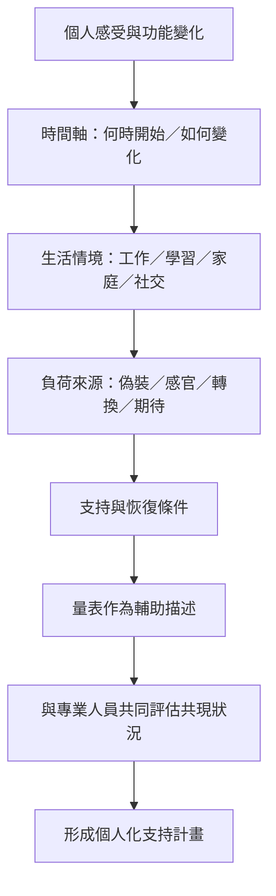

辨識倦怠時，可先由個人描述的長期變化開始，再詢問生活負荷、支持障礙、感官與認知變化。研究量表可以協助把經驗整理成可追蹤的指標，但不能取代醫療評估，也不能單憑分數將倦怠與憂鬱、睡眠或身體疾病區分。

## 參考
* [[自閉症倦怠量表能協助追蹤但尚不能取代臨床判斷]]整理量表用途與限制。
* [[身體症狀不能只用倦怠概念解釋]]及[[自閉症倦怠研究仍缺乏全球與高支持需求者代表性]]提醒辨識需要多元視角。
