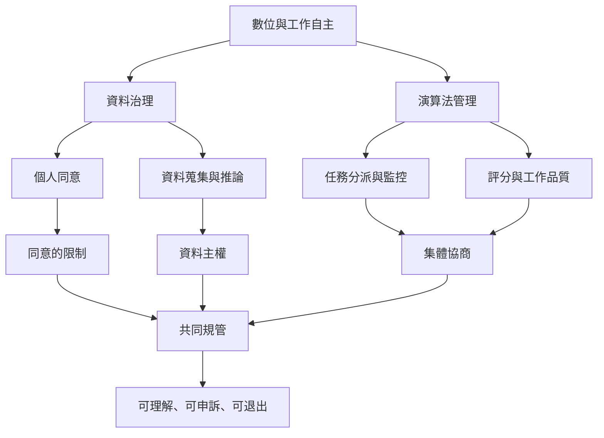

數位平台與演算法管理使自主問題從個人意志延伸到資料、監控、勞動安排與規則制定。使用者或勞動者若無法理解系統、取得自己的資料、申訴決策或參與規則設計，就可能只有形式選擇而缺乏實質自主。

延伸閱讀：[[監控與平台鎖定會縮減日常自主空間]]、[[數位自主需從個人同意拓展到集體治理]]、[[自主工具應該可理解可修改可離開]]、[[讓勞動者共同治理把工作自主從彈性升級為權力]]。

概念連結：[[資料主權]]、[[自主]]、[[集體自主]]、[[自我治理]]、[[能動性]]、[[共生性]]。

## 書庫索引

回到本書導讀：[[Autonomy]]。
