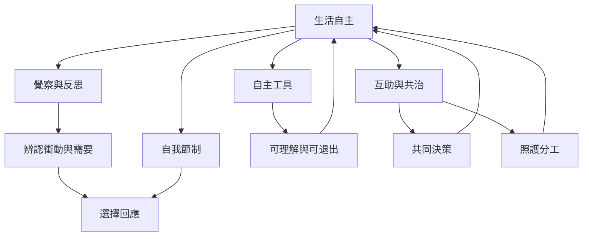

自主不只是一種權利或制度，也是一種日常實踐：理解自身動機、練習自我節制、覺察習性反應、使用不鎖定人的工具，以及和他人公平分擔生活維持工作。個人練習不能替代制度改革，但可與社群共治互相支持。

延伸閱讀：[[覺察能在刺激與反應之間創造選擇空間]]、[[自我節制能增加而非必然減少自主]]、[[自主工具應該可理解可修改可離開]]、[[為自主行動提供社會再生產基礎]]。

概念連結：[[自主]]、[[自主動機]]、[[能動性]]、[[互賴]]、[[共生性]]、[[社會再生產]]、[[Swaraj]]。

## 書庫索引

回到本書導讀：[[Autonomy]]。
