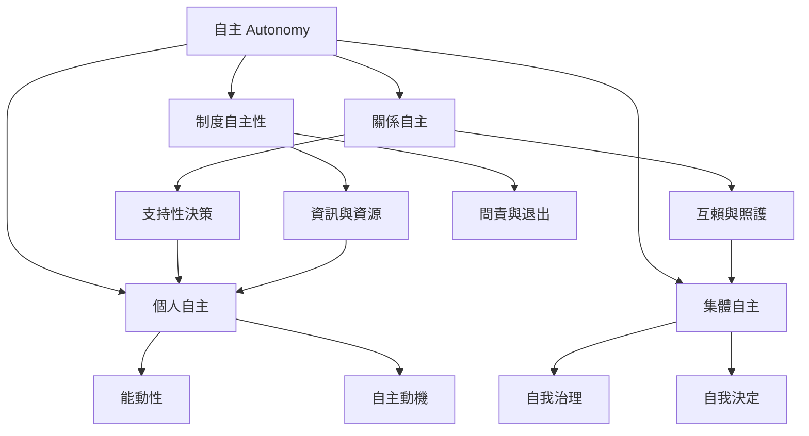

自主可從個人、關係、集體與制度等尺度理解。不同尺度彼此影響，卻不可互相替代：個人需要有權決定自己的生活，集體需要有能力制定共同規則，而制度則要確保資訊、資源、問責與退出的條件。

延伸閱讀：[[自主是對行動來源的作者身分而非拒絕依賴]]、[[個人自主與集體自治不能相互取代]]、[[自主可由制度層次衡量不應只當人格特質]]。

概念連結：[[自主]]、[[個人自主]]、[[關係自主]]、[[集體自主]]、[[能動性]]、[[互賴]]、[[自我決定]]、[[自我治理]]。

## 書庫索引

回到本書導讀：[[Autonomy]]。
