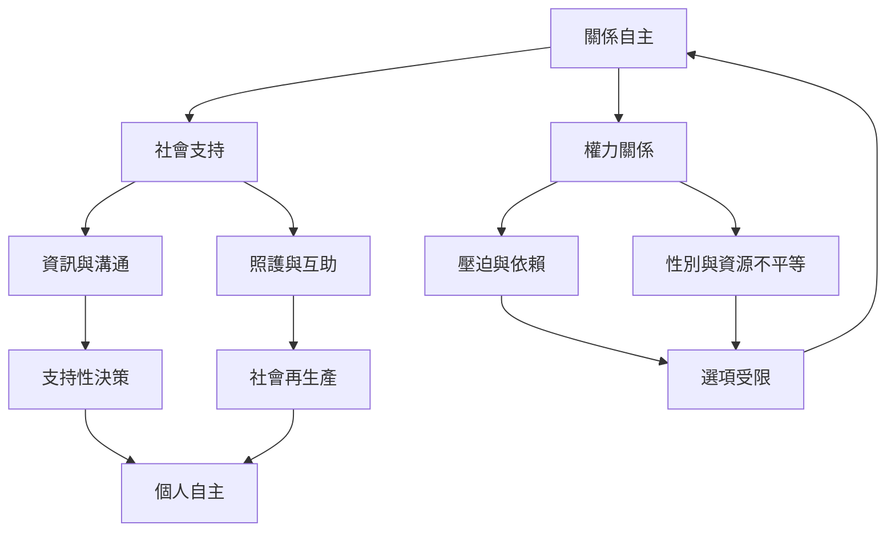

關係自主指出，自主能力是在社會關係中形成的。關係可能提供支持、信任、照護與能力，也可能藉由控制、歧視與不平等分工限制自主。照護制度因此必須同時保護受照護者與照護者的決定權。

延伸閱讀：[[個人自主的能力是在關係中被培養與維護]]、[[關係自主必須同時處理支持與壓迫]]、[[照護勞動使自主成為可能但也可能不平等分配]]、[[以支持而非代替決策設計照護關係]]。

概念連結：[[關係自主]]、[[互賴]]、[[支持性決策]]、[[社會再生產]]、[[Ubuntu]]、[[個人自主]]。

## 書庫索引

回到本書導讀：[[Autonomy]]。
