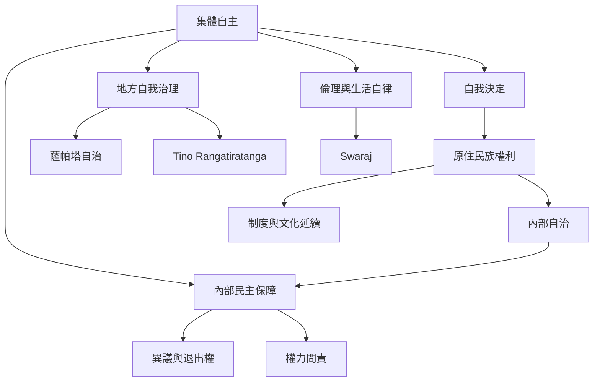

集體自治涉及共同體的政治主體性、制度維繫與內部民主。原住民族自決、薩帕塔自治、毛利人的 tino rangatiratanga 與甘地的 swaraj 各自形成於不同歷史，不應被化約成同一種模式；它們可共同用來比較權力、土地、制度與人民參與。

延伸閱讀：[[自決權是共同體維繫生活制度的權利]]、[[集體自治必須讓內部少數有反對與退出空間]]、[[個人自主與集體自治不能相互取代]]。

概念連結：[[集體自主]]、[[政治自治]]、[[自我決定]]、[[自我治理]]、[[Swaraj]]、[[Tino Rangatiratanga]]、[[Ubuntu]]。

## 書庫索引

回到本書導讀：[[Autonomy]]。
