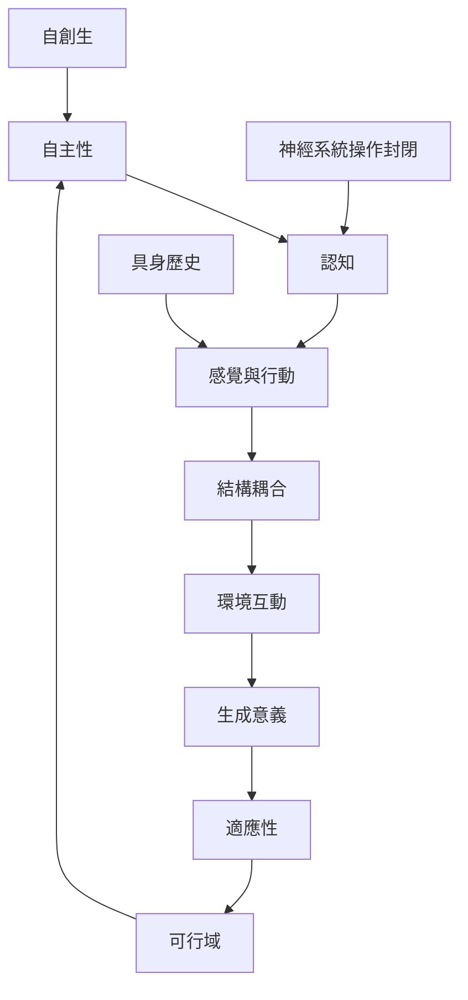

本圖呈現自創生如何連結自主性、認知、行動生成論與意義生成。核心不是把所有生命都說成有意識，而是把認知放回有機體維持自身可行性的感覺—行動歷程中。Di Paolo 的適應性概念補充了生命如何建立內在規範的說明。

核心閱讀順序：[[生命的認知性不等於有意識思考]] → [[行動生成論把認知理解為生物與環境的互動生成]] → [[適應性使自創生系統形成內在的可行性規範]] → [[生成意義是有機體依自身可行性評估環境的歷程]]。

## 相關概念
[[認知（Cognition）]]、[[行動生成論（Enactivism）]]、[[生成意義（Sense-making）]]、[[適應性（Adaptivity）]]、[[可行域（Viability Set）]]、[[神經系統的操作封閉（Operational Closure of Nervous System）]]、[[自主性（Autonomy）]]、[[結構耦合（Structural Coupling）]]。

## 延伸筆記
[[生命的認知性不等於有意識思考]]、[[適應性使自創生系統形成內在的可行性規範]]、[[生成意義是有機體依自身可行性評估環境的歷程]]、[[自創生與生命起源研究回答不同問題]]。

## 參考
[[《自創生與認知》把生命的自我生成連結到認知]]、[[Di Paolo指出自創生需加入適應性才能說明意義生成]]、[[Razeto-Barry重整自創生定義以釐清生命判準]]。

本書導讀：[[Autopoiesis]]。
