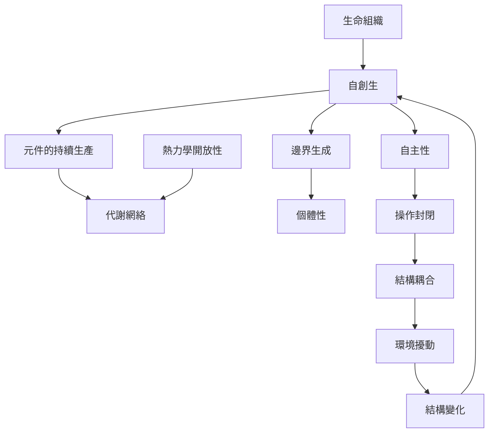

本圖從生命組織與自主性出發，整理自創生如何透過元件生產、邊界維持及環境耦合，持續實現生命個體。閱讀時應優先掌握組織與結構、操作封閉與熱力學開放的差異。

核心閱讀順序：[[自創生是持續自我生產的組織模式]] → [[系統邊界由內部生產網絡持續維持]] → [[自創生系統在物質交換上開放但在組織上封閉]] → [[結構耦合讓自主系統與環境互相制約]]。

## 相關概念
[[自創生（Autopoiesis）]]、[[生命組織（Organization of the Living）]]、[[自主性（Autonomy）]]、[[操作封閉（Operational Closure）]]、[[結構耦合（Structural Coupling）]]、[[自我指涉（Self-reference）]]、[[組織與結構（Organization and Structure）]]、[[自我組織（Self-organization）]]、[[異創生（Allopoiesis）]]、[[代謝網絡（Metabolic Network）]]、[[邊界生成（Boundary Production）]]、[[熱力學開放性（Thermodynamic Openness）]]。

## 延伸筆記
[[自創生是持續自我生產的組織模式]]、[[自創生判準關注組織而非構成元件的清單]]、[[自創生系統在物質交換上開放但在組織上封閉]]、[[結構耦合讓自主系統與環境互相制約]]。

## 參考
[[1974年模型將自創生組織轉化為可檢驗的形式描述]]、[[Maturana將自主性定位為生命組織的核心]]、[[Luisi將自創生定位為細胞生命的操作性藍圖]]。

本書導讀：[[Autopoiesis]]。
