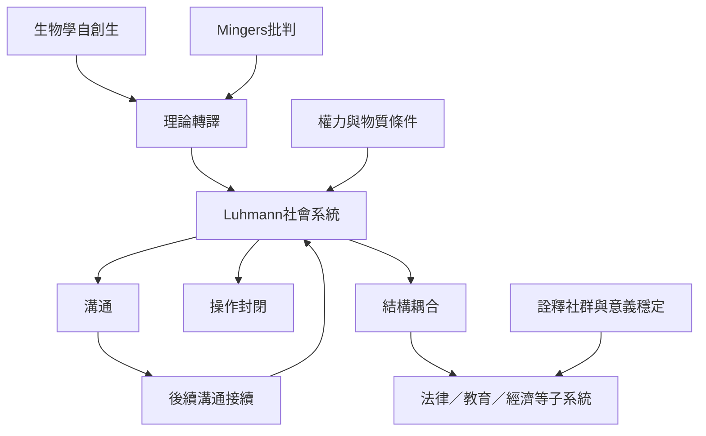

本圖把 Luhmann 的社會系統理論視為一種跨領域轉譯：社會系統以溝通作為基本操作，透過溝通接續來再生產自身；操作封閉與結構耦合讓系統能維持自身運作又受環境刺激。圖中也放入批判路徑，提醒這種轉譯需要回答權力、物質條件與個體經驗問題。

核心閱讀順序：[[社會系統的自創生是理論轉譯而非生物學同一]] → [[社會系統以溝通而非個人作為基本操作]] → [[操作封閉不等於與外界隔絕]] → [[自創生理論的跨領域轉譯必須保留概念層次差異]]。

## 相關概念
[[社會系統（Social System）]]、[[溝通（Communication）]]、[[功能分化（Functional Differentiation）]]、[[操作封閉（Operational Closure）]]、[[自我指涉（Self-reference）]]、[[結構耦合（Structural Coupling）]]。

## 延伸筆記
[[盧曼以溝通的再生產解釋社會系統]]、[[Mingers質疑社會系統能否符合生物自創生的嚴格定義]]、[[社會系統研究必須區分系統再生產與人的生活經驗]]、[[社會系統分析必須把權力與物質條件納入]]、[[操作封閉不能單獨說明社會意義如何穩定]]。

## 參考
[[日本研究以Pask會話理論闡釋社會系統的持續運作]]、[[日本認知研究重新檢視系統理論中的認識問題]]、[[法律系統透過法律溝通再生產自身的規範]]。

本書導讀：[[Autopoiesis]]。
