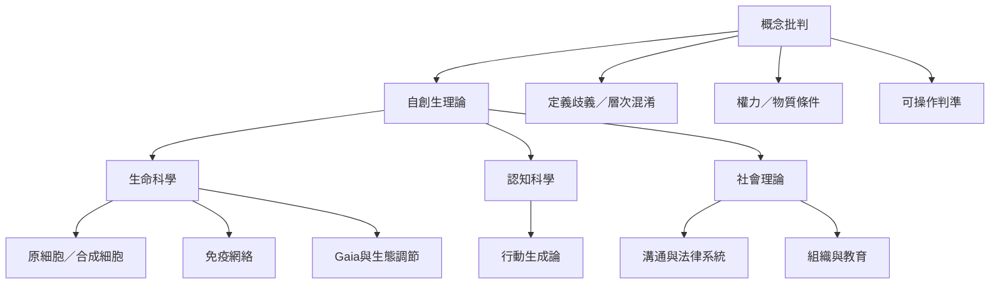

本圖整理自創生理論的研究前沿：原細胞與合成細胞研究測試生命樣系統的形成；免疫網絡提供生物學內部的網絡模型爭論；Gaia 假說涉及生物圈整體調節；社會、法律與組織研究則是概念轉譯。跨域研究的共同要求，是說明系統邊界、被生產的單位、維持機制與可反駁條件。

核心閱讀順序：[[自創生理論的跨領域轉譯必須保留概念層次差異]] → [[原細胞研究不能直接等同已證實的自創生生命]] → [[免疫網絡觀提供自我維持的案例但仍有科學爭論]] → [[生態系統的調節性不能直接證明地球是單一自創生個體]] → [[社會系統分析必須把權力與物質條件納入]]。

## 相關概念
[[化學自創生（Chemical Autopoiesis）]]、[[原細胞（Protocell）]]、[[自我複製（Self-replication）]]、[[熱力學開放性（Thermodynamic Openness）]]、[[恆定性（Homeostasis）]]、[[社會系統（Social System）]]。

## 延伸筆記
[[自創生與生命起源研究回答不同問題]]、[[概念延伸要用反例維持理論的可檢驗性]]、[[操作封閉不能單獨說明社會意義如何穩定]]、[[生態系統的調節性不能直接證明地球是單一自創生個體]]。

## 參考
[[原細胞研究呈現從自組裝到選擇演化的漸進路徑]]、[[2026人工細胞研究展示脂質液滴的非對稱分裂]]、[[Gaia假說的地球自我調節主張仍須接受演化生態學檢驗]]、[[國際法自創生研究指出封閉性無法自動解釋法律意義穩定]]。

本書導讀：[[Autopoiesis]]。
