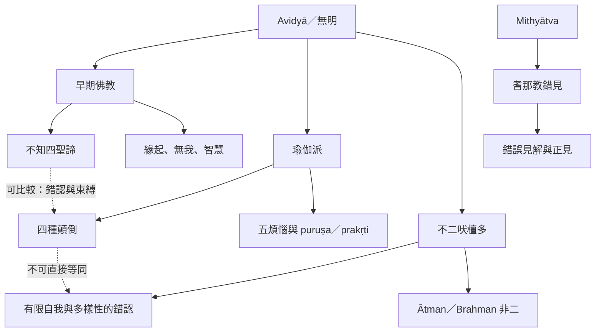

印度思想中的 *avidyā* 不是單一教義。早期佛教、瑜伽派、不二吠檀多各自在不同的主體觀、世界觀與解脫論中使用相近詞彙；耆那教的 *mithyātva* 則可作錯見概念的比較案例。下圖強調各傳統的核心關懷，而非將它們合併。

比較時應同時保留相似問題與不可互換前提：佛教不以永恆自我為究竟實在；不二吠檀多則以 Ātman／Brahman 非二為核心。瑜伽派另有 *puruṣa* 與 *prakṛti* 的二元架構。相關文獻見[[早期佛教以四聖諦界定無明而不只是缺少資訊]]、[[瑜伽經以四種顛倒界定無明]]、[[不二吠檀多以無明解釋個體自我與梵的錯認]]與[[耆那教以 mithyātva 描述錯見但不可直接等同佛教無明]]。

## 概念連結
[[Avidyā]]、[[Avijjā]]、[[Vidyā]]、[[瑜伽經]]、[[伊莎奧義書]]、[[不二吠檀多]]、[[Mithyātva]]、[[無我]]。
