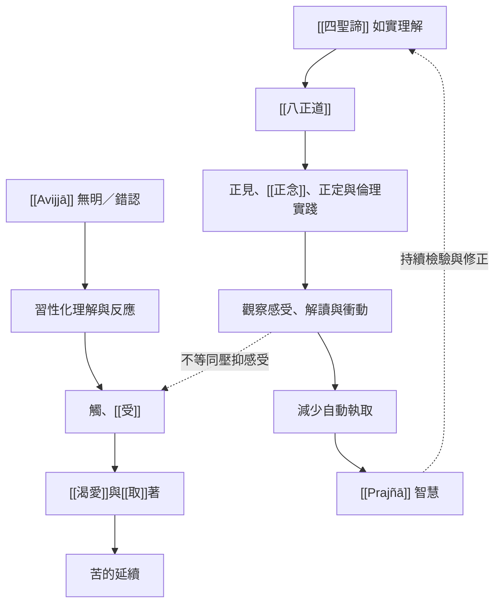

這張概念地圖把無明的止息理解為一個整合過程：如實理解苦與條件，培養正見與正念，觀察觸受愛取之間的反應，逐步減弱煩惱與實體化執取。它不是一種保證固定結果的技術流程，而是把經典的診斷、修行與日常觀察放在同一張圖上。

這張圖將「感受與渴愛之間的反應空間」當成修行者可觀察的實踐環節。詳見[[感受與渴愛之間存在可觀察的反應空間]]、[[破除無明不是累積資訊而是培養如實知]]與[[去除煩惱與解除認知遮蔽是相關但不同的修行層次]]。

## 概念連結
[[無明]]、[[四聖諦]]、[[八正道]]、[[緣起]]、[[渴愛]]、[[Prajñā]]、[[正見]]、[[正念]]。
