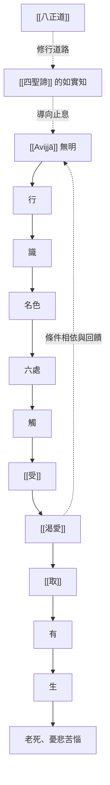

早期佛教以無明作為十二支緣起的條件起點，說明苦如何透過一連串相依條件持續。這張圖將無明、行、識、名色、六處、觸、受、愛、取、有、生、老死連在一起；它是分析模型，不是要求把每一支理解為單向、單次、線性發生的時間順序。

閱讀時可搭配[[緣起將無明視為條件網絡而非宇宙第一因]]、[[感受與渴愛之間存在可觀察的反應空間]]及[[破除無明不是累積資訊而是培養如實知]]。此圖中的回饋箭頭是分析上的互相條件化提示，不是十二支經文的固定額外支分。

## 概念連結
[[Avijjā]]、[[四聖諦]]、[[緣起]]、[[受]]、[[渴愛]]、[[取]]、[[八正道]]、[[正見]]。
