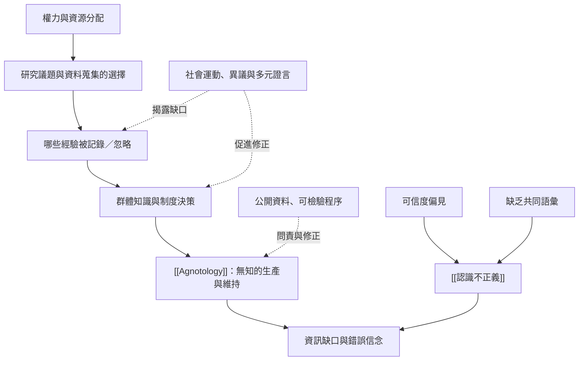

無知也可能由社會制度與權力關係生產。這張圖呈現資訊缺席、研究資源、可信度分配與語彙缺口如何影響群體知道什麼；而社會運動、公共研究、異議與修正機制，則可能協助揭露並改變這些缺口。

這套分析與個人修行中的無明並不相同，但可以互補：個人需要觀察自身的錯認，群體則需檢查哪些制度條件讓特定事實難以被知道。詳見[[無知學研究無知如何被政治經濟生產]]、[[女性主義認識論把無知視為可研究的知識狀態]]、[[社會認識論指出無知可在群體中分配與維持]]。

## 概念連結
[[Agnotology]]、[[認識不正義]]、[[社會認識論]]、[[無知可以是個人盲點也可以是制度性成果]]、[[知識生產需要認識正義與多元觀點]]。
