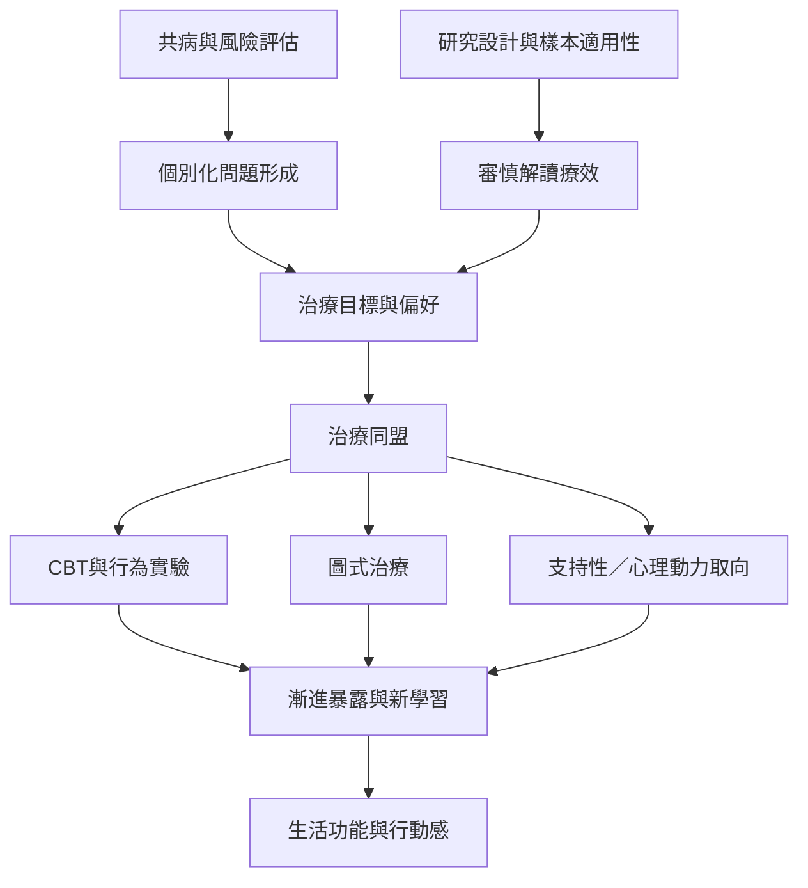

迴避型人格的治療必須同時處理個人問題形成、關係安全、療法可接受度與證據適用性。現有研究提示多種心理治療可能有幫助，但專屬研究仍不足；共病樣本的結果不能直接推廣至所有人。

閱讀路徑：[[data/臨床回顧認為迴避型人格障礙仍是研究不足的領域]] → [[data/圖式治療與認知行為治療對共病患者均有改善]] → [[note/治療證據應按研究設計與樣本適用性分級]]。

概念連結：[[term/治療同盟]]、[[term/漸進暴露]]、[[term/圖式治療]]、[[term/行動感]]、[[term/價值導向行動]]。
