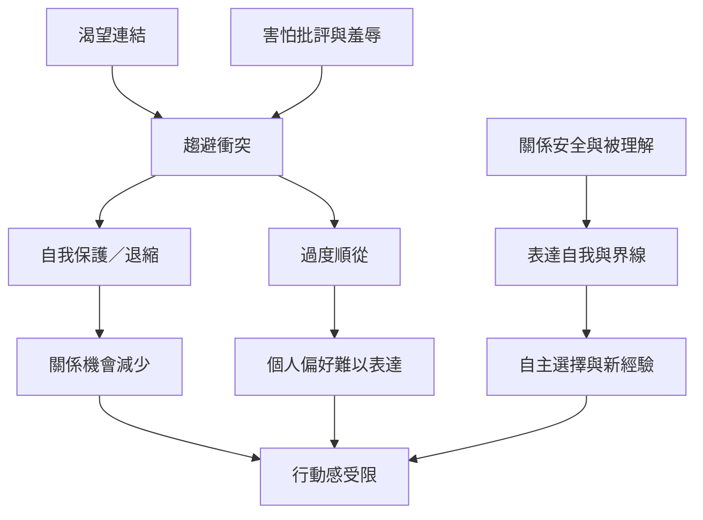

質性研究讓迴避困難不再只被看成外顯退縮，而能看見連結渴望、靠近恐懼、自我懷疑、過度順從、界線與行動感。重要問題是：當事人是否能在不失去關係安全的情況下表達自己、選擇參與或拒絕。

閱讀路徑：[[data/當事人描述迴避型人格包含連結渴望與靠近恐懼]] → [[data/避免型人格困難者在日常生活與治療中的行動感研究於二零二六年發表]] → [[note/復原可以從恢復可選擇的行動而非增加社交數量開始]]。

概念連結：[[term/行動感]]、[[term/自我概念]]、[[term/界線]]、[[term/趨避衝突]]、[[term/治療同盟]]、[[term/主體性]]。
