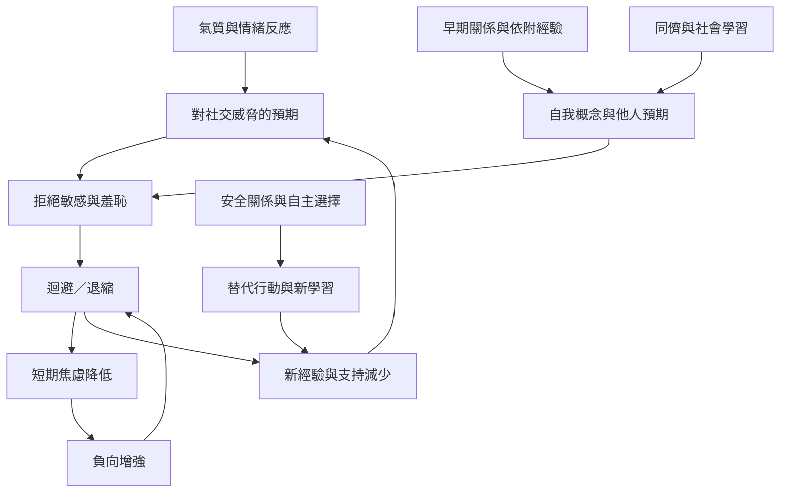

迴避特徵可由氣質、早期關係、同儕經驗、社會學習與當下環境交互影響。這不是單一路徑的因果圖，而是整理可能彼此作用的因素。迴避若帶來即時舒緩，可能受到負向增強而重複；若環境改變並提供安全的新經驗，循環也可能鬆動。

閱讀路徑：[[data/童年預測因子研究提醒早期害羞並非單一必然前因]] → [[note/迴避特徵是個人脆弱性與環境互動的發展結果]] → [[note/迴避可能保護個體免於受傷卻也逐漸縮小生活空間]]。

概念連結：[[term/氣質]]、[[term/依附風格]]、[[term/社會學習]]、[[term/自我概念]]、[[term/拒絕敏感度]]、[[term/經驗迴避]]、[[term/負向增強]]、[[term/趨避衝突]]。
