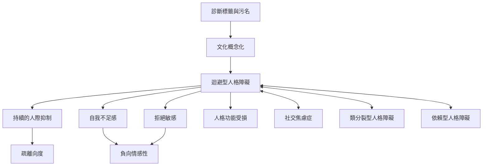

迴避型人格的診斷不只是核對某幾項行為，而是把持續模式、自我與人際功能、痛苦程度及文化脈絡放在一起理解。DSM-5-TR 的類別準則與 ICD-11 的維度描述提供不同視角；社交焦慮、類分裂型人格及依賴型人格是重要鑑別方向。

閱讀路徑：先讀[[data/DSM-5-TR診斷標準必須放回持續模式與功能脈絡理解]]，再讀[[data/ICD-11以人格功能嚴重度與特質向度取代固定類型]]及[[note/社交焦慮症與迴避型人格障礙重疊但不能互相取代]]。

概念連結：[[term/迴避型人格障礙]]、[[term/人格功能]]、[[term/負向情感性]]、[[term/疏離]]、[[term/社交焦慮症]]、[[term/對人恐怖]]、[[term/污名]]、[[term/文化概念化]]。
