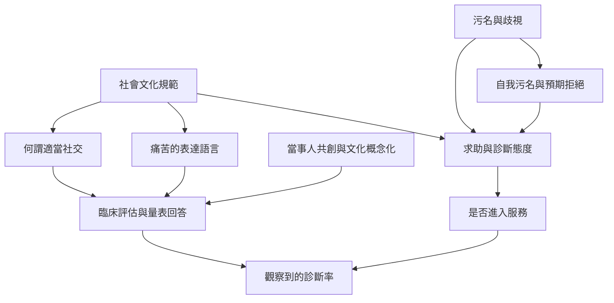

文化不是附加在診斷之後的裝飾，而是影響人們如何命名痛苦、理解社交規範、求助與接受診斷的脈絡。對人恐怖可用來思考焦慮焦點的文化差異，但不可把文化群體本質化。

閱讀路徑：[[data/亞洲人格障礙盛行率研究指出跨文化資料仍不足]] → [[data/日本對人恐怖研究顯示社交恐懼可能以他人為焦點]] → [[note/文化比較應研究焦慮的意義而非排列文化高低]]。

概念連結：[[term/文化概念化]]、[[term/對人恐怖]]、[[term/污名]]、[[term/社交焦慮症]]、[[term/迴避型人格障礙]]。
