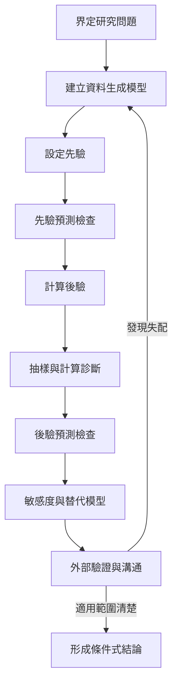

實務貝葉斯分析不是公式計算的一次性流程，而是從問題界定、先驗設定、資料生成模型、計算診斷，到預測檢查、敏感度分析與模型修訂的循環。計算可靠性與模型適切性是兩項不同檢驗。

延伸概念：[[貝葉斯分析是一個反覆建模與檢查的工作流程]]、[[先驗分布必須被說明而不是藏在分析流程裡]]、[[先驗敏感度分析揭露資料與假設各自貢獻多少]]、[[可信的貝葉斯推論必須讓模型反覆接受資料檢查]]、[[計算收斂只是可信推論的必要條件而非充分條件]]、[[近似後驗不是完整後驗，計算便利必須和誤差一起評估]]。
