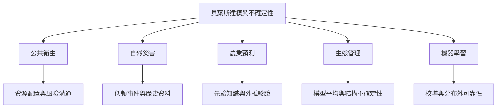

跨領域案例顯示，貝葉斯方法的價值通常不是消除不確定性，而是把資料缺口、群體差異、歷史資訊與模型假設放進可檢查的推論結構。不同領域對「錯誤」與「可接受風險」的定義不同，因此建模之後仍需領域驗證與公共溝通。

延伸概念：[[迦納瘧疾風險研究展示貝葉斯時空模型的公共衛生用途]]、[[南非HIV資料顯示貝葉斯階層模型能分析設施差異與區域風險]]、[[中國結核病研究以貝葉斯時空模型分析疾病變化]]、[[日本地震與海嘯研究顯示歷史資料可補足稀少事件的不確定性]]、[[印度作物產量預測展示先驗知識對小樣本迴歸的角色]]、[[深度學習的貝葉斯方法提供參數與預測不確定性但仍有近似限制]]、[[FDA在2026年提出臨床試驗貝葉斯方法草案指引]]。
