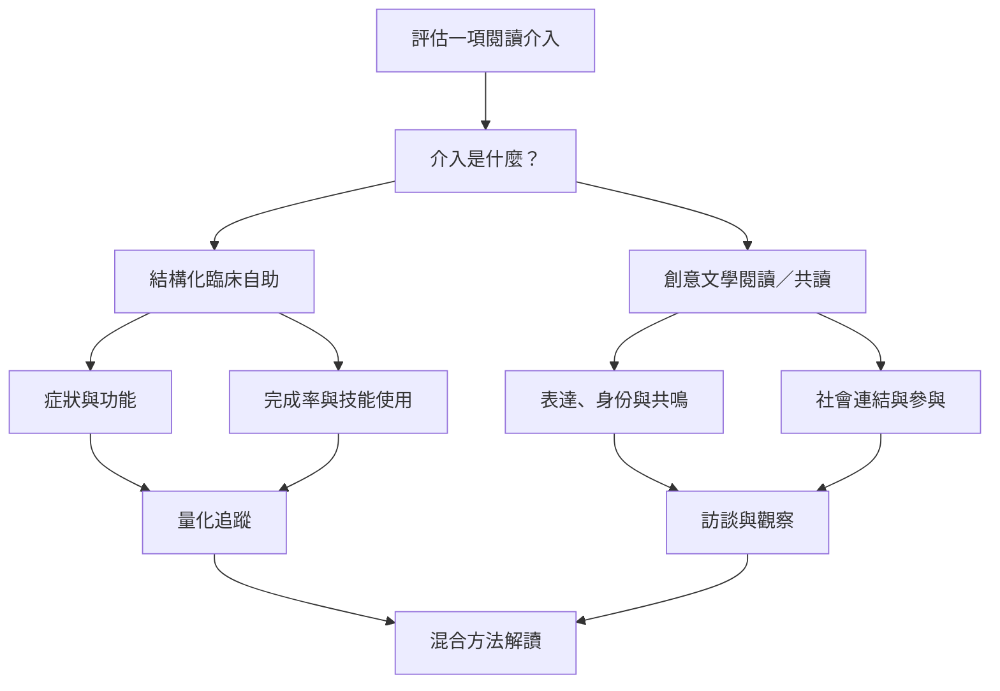

讀書療法的證據並不平均分布。結構化 CBT 自助及引導式自助有較多臨床試驗與指引支持，尤其在較輕度成人憂鬱症的特定條件下；創意文學閱讀、校園閱讀與共讀更常呈現質性經驗、初步試驗或異質性較高的研究。評估時必須分清介入類型與族群。

## 證據來源
- 臨床指引與試驗：[[NICE將引導式自助列為較輕度成人憂鬱症的初線選項之一]]、[[格拉斯哥試驗指出短時支持可配合CBT自助讀物]]、[[泰國隨機試驗支持讀書療法手冊作為常規照護的輔助工具]]。
- 年齡與場域差異：[[成人憂鬱症讀書療法的長期研究結果不等同於兒少結果]]、[[學校創意讀書療法有希望但兒少證據品質仍弱]]。
- 社群與高齡：[[高齡共讀回顧顯示社會連結是重要可能效益]]、[[挪威癌症共讀參與者經驗指出閱讀群體提供疾病之外的空間]]。

## 評估原則
[[讀書療法評估必須同時看症狀經驗與社會參與]]、[[創意讀書療法與CBT自助讀物需要分開評估]]、[[實證實踐]]。

## 回到導讀
[[Bibliotherapy]]
