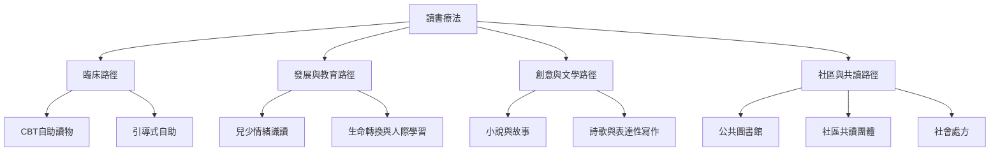

讀書療法是一組以文本和閱讀經驗支持個人或社群的實踐。不同類型在目標、材料、專業責任和證據基礎上存在差異：臨床自助偏向結構化技能練習；發展性與創意閱讀重視理解、表達與成長；共讀則把共同注意與人際連結納入介入。

## 路徑索引
- 臨床與自助：[[臨床讀書療法]]、[[引導式自助]]、[[自助閱讀不能取代必要的診斷治療與危機支持]]。
- 發展與教育：[[發展性讀書療法]]、[[創意讀書療法]]。
- 文學與表達：[[詩歌療法]]、[[認同]]、[[情緒宣洩]]、[[洞察]]。
- 社區與關係：[[共讀]]、[[社會處方]]、[[社會連結]]。

## 相關筆記
[[讀書療法不是單一治療而是依情境分化的介入家族]]、[[創意讀書療法與CBT自助讀物需要分開評估]]、[[共讀把閱讀從個人活動轉變為關係性支持]]、[[公共圖書館能提供低污名健康資源但不能取代臨床照護]]。

## 回到導讀
[[Bibliotherapy]]
