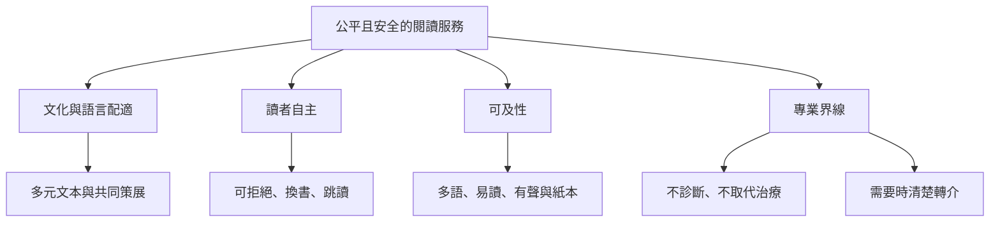

讀書療法的設計不只是選一本「有療癒力」的書，也涉及語言、文化、閱讀能力、專業權力、隱私與轉介責任。跨地區經驗提醒我們：圖書館和社區組織可以提供低污名入口，但必須清楚界定不取代臨床照護；推薦者則要保留讀者選擇與拒絕的空間。

## 設計要點
- 文化：[[文化謙遜]]、[[閱讀療法的效果取決於讀者文本目標與文化情境的配適]]、[[語言與文化配適是閱讀療法有效性的基本條件]]。
- 自主：[[推薦書目涉及專業權力應保留讀者自主]]、[[把閱讀處方改寫成邀請而非指令]]。
- 可及：[[閱讀療法的可及性受語言閱讀能力與數位落差影響]]。
- 安全：[[創傷知情實踐]]、[[自助閱讀不能取代必要的診斷治療與危機支持]]。
- 社區：[[公共圖書館能提供低污名健康資源但不能取代臨床照護]]、[[建立從圖書館到專業服務的溫和轉介路徑]]。

## 回到導讀
[[Bibliotherapy]]
