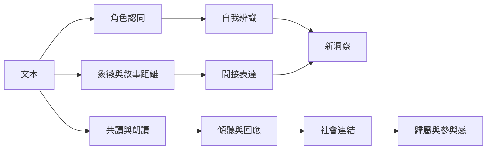

閱讀可以透過故事認同、敘事距離、情緒接觸與新洞察，協助讀者理解自身經驗；當閱讀發生在團體中，朗讀與對話又可能創造歸屬、社會連結和共同理解。這些都是可能路徑，不是每個人必然經歷的固定階段。

## 可能機制
- 個人層次：[[認同]]、[[敘事沉浸]]、[[情緒宣洩]]、[[洞察]]、[[觀點採取]]。
- 間接表達：[[敘事距離讓困難經驗得以間接探索]]、[[創傷知情實踐]]。
- 社會層次：[[共讀]]、[[社會連結]]、[[社會處方]]。

## 相關永久筆記
[[文本與讀者的互動比書名本身更接近讀書療法的作用核心]]、[[認同讓讀者借用角色的經驗辨認自身困境]]、[[敘事距離讓困難經驗得以間接探索]]、[[共讀把閱讀從個人活動轉變為關係性支持]]。

## 回到導讀
[[Bibliotherapy]]
