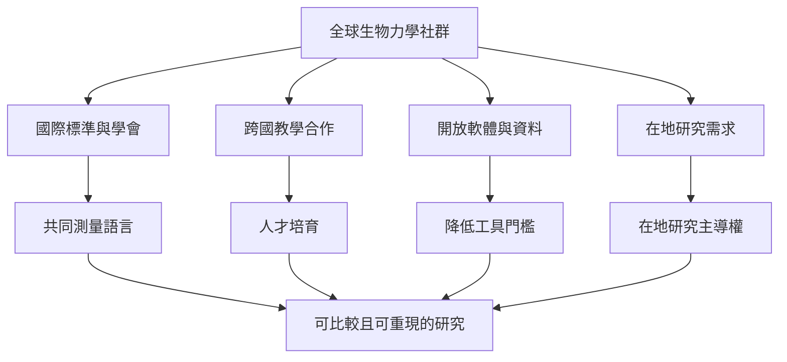

生物力學是一個全球研究領域，但研究資源與人才分布並不平均。國際標準、開放軟體、遠距教學、專業學會和青少年推廣能促進跨國交流；真正公平的合作還需在地研究者共同定義問題並持續參與。

雙向連結：[[國際生物力學學會以標準與社群連結全球研究者]]、[[非洲生物力學發展顯示研究能力與資源分配密切相關]]、[[巴西與南非的跨國教學合作把生物力學教育帶過國界]]、[[國家生物力學日於2026年呈現跨國教育合作的擴張]]、[[生物力學的全球化必須理解知識生產的地理條件]]。

本筆記所屬書庫：[[Biomechanics]]。
