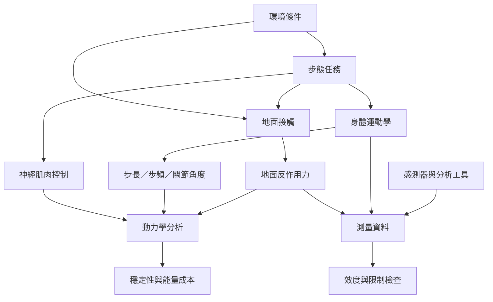

步態是身體與地面共同形成的動態過程。分析時需要結合身體節段的運動學、外部接觸力、肌肉控制和任務環境，也需要分辨實驗室量測與日常生活的差異。

雙向連結：[[步態是人在環境中週期性移動的動作組織]]、[[地面反作用力是地面對人體接觸施加的作用力]]、[[慣性感測器以加速度與角速度追蹤身體運動]]、[[測量效度描述工具是否測到預定的目標]]、[[測量信度描述重複測量的一致程度]]。

本筆記所屬書庫：[[Biomechanics]]。
