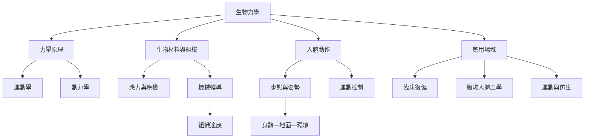

生物力學的總圖從力學原理出發，向下連結組織材料與細胞機械轉導，向外連結人體動作、醫療、工作、文化與環境。它不是單一學科分支，而是一組依研究尺度和問題組合的方法。

可從[[生物力學是以力學原理解釋生物結構與運動]]開始，再連到[[運動學描述運動而不直接解釋運動成因]]、[[動力學研究造成或抵抗動作的力]]、[[機械轉導是細胞把物理刺激轉成生化訊號的過程]]及[[步態是人在環境中週期性移動的動作組織]]。應用面則見[[復健應以功能與參與為中心而不只追求動作正常化]]、[[職場人體工學應優先改善工作系統而不是責備個人]]。

本筆記所屬書庫：[[Biomechanics]]。
