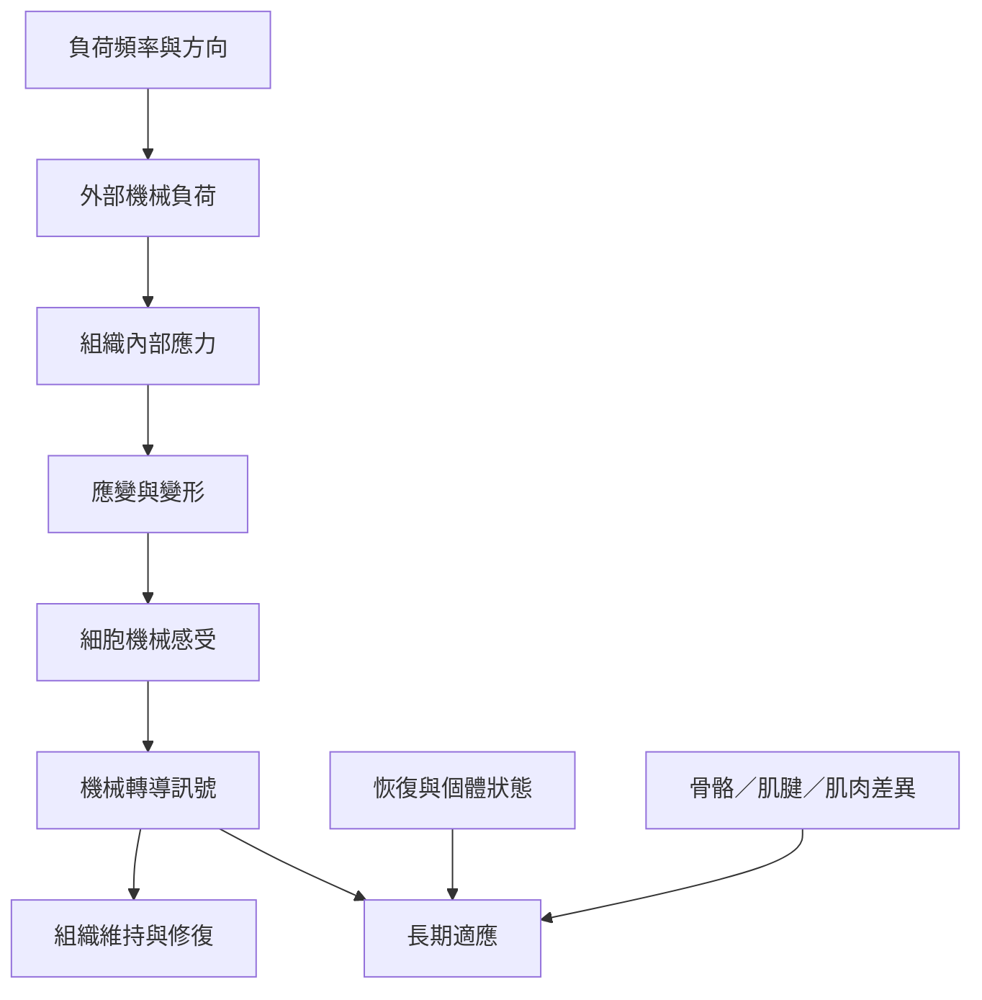

組織力學從外部負荷出發，經過組織內部應力與應變，連接細胞感受、訊號傳遞和長期適應。不同組織的材料性質與生物調節機制不相同，因此不能把骨、肌腱和肌肉的適應規則視為同一套。

雙向連結：[[機械應力描述單位面積承受的內部負荷]]、[[機械應變描述材料形狀或尺寸的相對改變]]、[[材料力學性質描述組織如何回應負荷]]、[[機械轉導是細胞把物理刺激轉成生化訊號的過程]]、[[組織適應是生物系統對長期負荷變化的調節]]、[[肌腱是連接肌肉與骨骼並傳遞力量的結締組織]]。

本筆記所屬書庫：[[Biomechanics]]。
