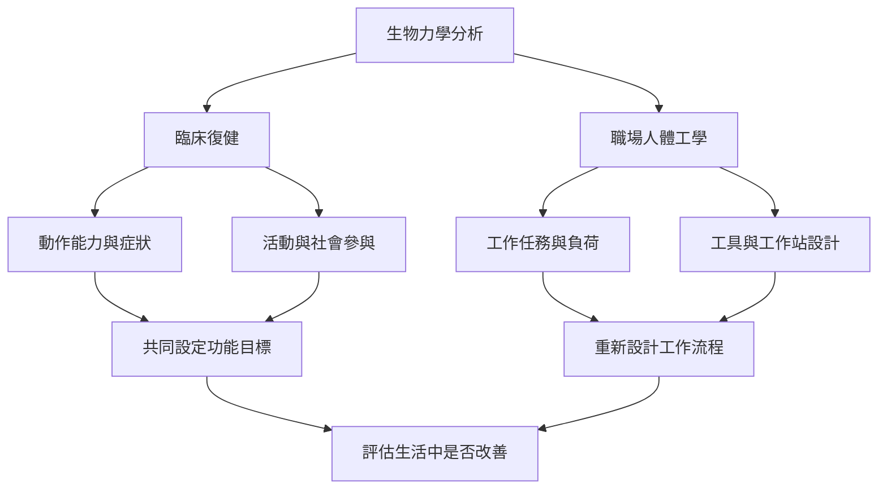

臨床與職場應用都需要把力學分析轉成有意義的功能改善。臨床關注個人的活動、參與與生活品質；職場則關注任務流程、工具、工作站和組織安排。兩者都不應把複雜問題簡化成個人姿勢對錯。

雙向連結：[[復健應以功能與參與為中心而不只追求動作正常化]]、[[職場人體工學應優先改善工作系統而不是責備個人]]、[[世界衛生組織復健套組把肌肉骨骼照護連結到制度規劃]]、[[NIOSH搬運方程式把工作負荷轉成可評估的風險條件]]。

本筆記所屬書庫：[[Biomechanics]]。
