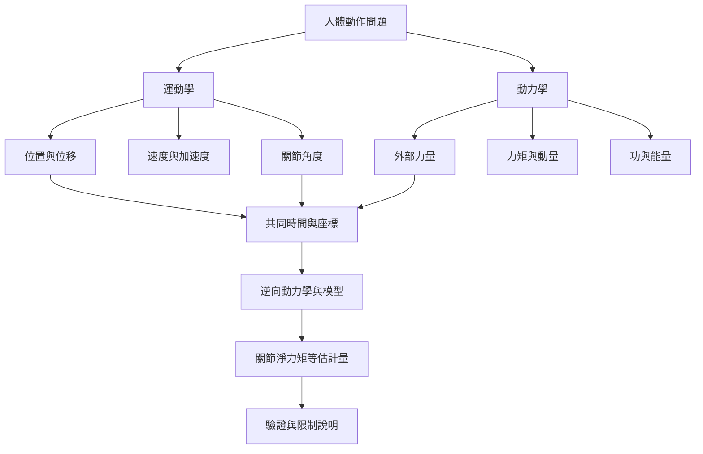

人體動作分析至少需要兩種互補問題：動作如何發生，以及什麼力量造成或抵抗動作。運動學提供運動描述，動力學提供力學解釋；兩者以共同座標系和時間基準對齊後，才能進行可比較的分析。

雙向連結：[[運動學描述運動而不直接解釋運動成因]]、[[動力學研究造成或抵抗動作的力]]、[[力是能改變物體運動或形狀的交互作用]]、[[力矩是力對轉軸產生的轉動效果]]、[[反向動力學是由運動與外力推算關節淨力矩的方法]]、[[關節座標系是描述關節三維運動的共同參考架構]]。

本筆記所屬書庫：[[Biomechanics]]。
