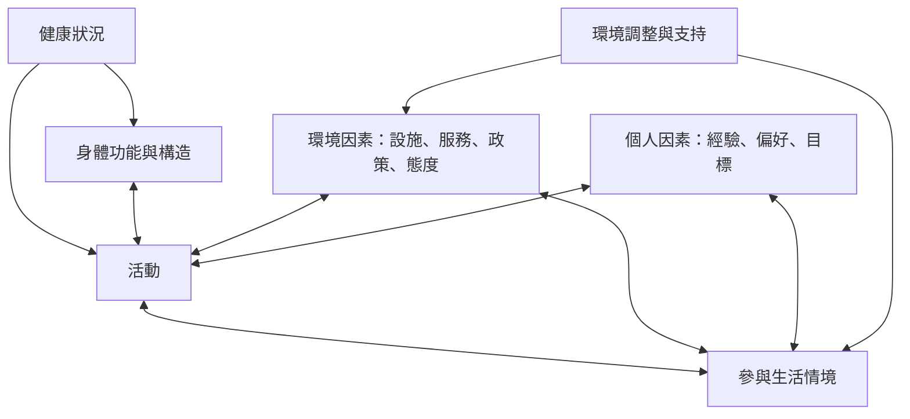

這張地圖聚焦 ICF 如何把健康狀況放回活動、參與與環境脈絡。它適合用於復健、身心障礙服務、教育、工作與社區活動設計，幫助團隊辨識哪些限制可透過環境改造而非只靠個人訓練解除。

核心筆記：[[ICF把健康功能放回個人與環境互動之中]]、[[環境改造可以比個人訓練更直接地解除參與障礙]]。

原始資料：[[世界衛生組織以ICF建立健康功能與環境因素的共同語言]]、[[Wade與Halligan主張生物心理社會模型已適合用來理解疾病與失能]]、[[台灣ICF實務說明展示環境支持如何改變活動與參與]]。

概念連結：[[國際健康功能與身心障礙分類系統]]、[[身心障礙社會模式]]、[[參與]]、[[健康公平]]。
