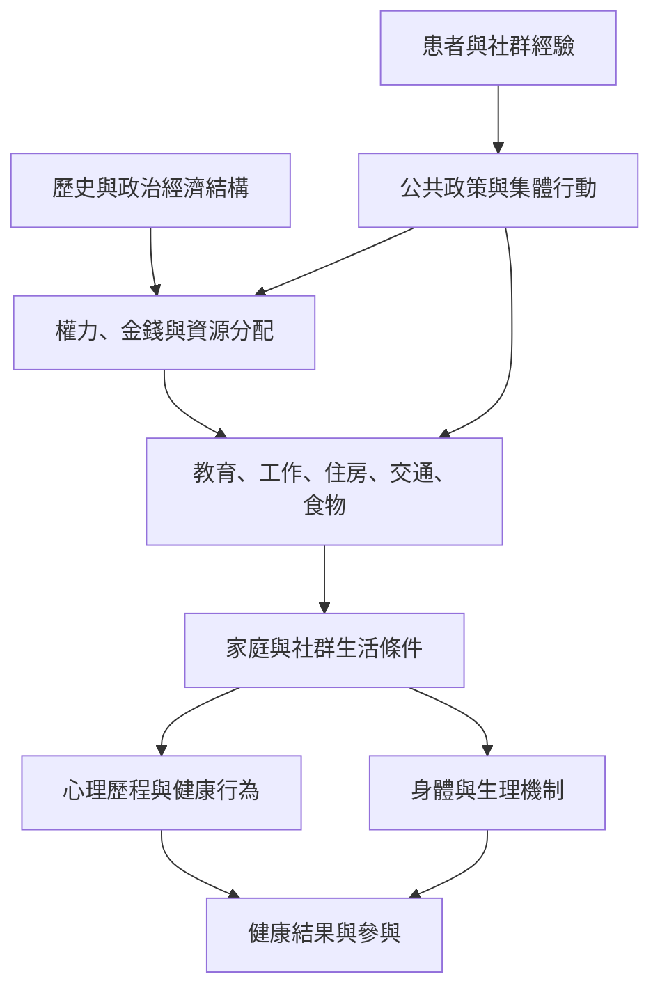

這張地圖把全球健康社會決定因素的政策框架，與拉丁美洲批判社會流行病學、英國健康不平等研究、南非患者訪談及台灣在地實務並置。重點是從「社會因素是什麼」走向「這些因素如何被制度生產、如何影響健康機會」。

核心筆記：[[健康風險的個人差異往往由社會資源分配所塑造]]、[[社會決定作用要求分析疾病背後的歷史與制度過程]]、[[拉丁美洲集體健康與結構性能力都要求看見疾病的制度根源]]、[[多層次健康分析必須同時辨認個人能動性與制度責任]]。

區域資料：[[WHO社會健康決定因素委員會把健康不平等連結到權力資源與日常生活條件]]、[[Marmot Review指出英格蘭健康差距沿著社會階層呈現梯度]]、[[Breilh以拉丁美洲批判社會流行病學追問健康風險如何被社會生產]]、[[南非開普敦HIV治療訪談呈現個人關係與制度障礙的交互作用]]、[[台灣ICF實務說明展示環境支持如何改變活動與參與]]。

概念連結：[[健康的社會決定因素]]、[[社會決定作用]]、[[健康公平]]、[[結構性能力]]、[[辛迪米克理論]]、[[社會支持]]。
