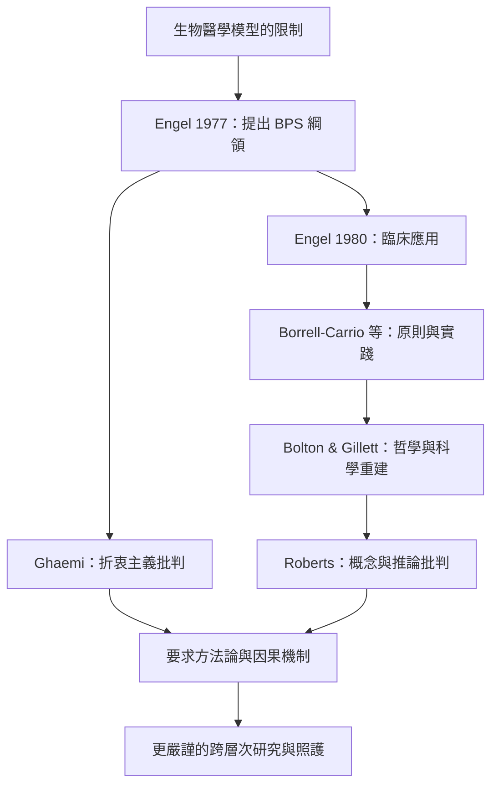

這張地圖追蹤 Engel 如何從對生物醫學模型的批判提出跨層次研究綱領，以及後續臨床深化、哲學重建與知識論批判。閱讀重點是分辨模型作為臨床哲學、研究綱領與因果理論時，各自需要什麼證據。

核心筆記：[[生物心理社會模型的臨床價值來自多層次理解而非三欄分類]]、[[生物心理社會模型若沒有機制就容易淪為空泛口號]]、[[臨床整合需要交代因素之間的機制與互相調節]]、[[模型的包容性不能取代清楚的因果問題與證據標準]]。

原始資料：[[Engel於1977年提出生物心理社會模型以挑戰單一生物醫學觀]]、[[Engel於1980年以心肌梗塞案例展示模型的臨床意義]]、[[Borrell-Carrio等人將生物心理社會模型整理為臨床哲學與實作指引]]、[[Bolton與Gillett以哲學與科學新發展重新建構生物心理社會模型]]、[[Ghaemi批評生物心理社會模型可能退化成沒有方法論約束的折衷主義]]、[[Roberts指出生物心理社會模型的包容性可能掩蓋概念與推論問題]]。

概念連結：[[生物心理社會模型]]、[[生物醫學模型]]、[[一般系統理論]]、[[心理神經免疫學]]。
