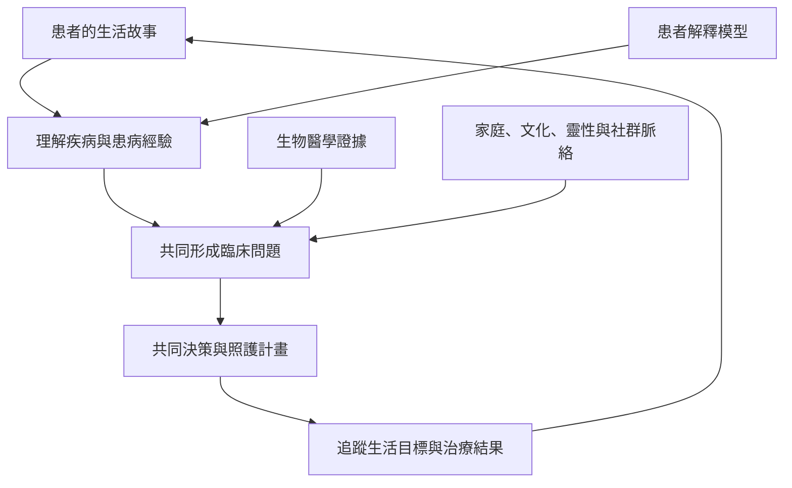

這張地圖將模型帶回診療現場：臨床者如何聆聽患者、理解其解釋模型、把故事轉成共同決策，以及在跨文化情境中避免專業者壟斷問題定義權。敘事與文化理解是臨床知識的一部分，但不能取代必要的生物醫學評估。

核心筆記：[[患者的解釋模型是臨床資料而不是需要排除的雜訊]]、[[敘事醫學讓患者的生活故事進入照護推理]]、[[跨文化照護必須讓在地知識參與問題定義]]、[[健康模型必須尊重其文化知識傳統而非將其互相化約]]。

原始資料：[[Kleinman等人提出病人解釋模型與跨文化照護提問]]、[[Kleinman的疾病敘事研究把患病經驗視為醫療工作的一部分]]、[[Charon的敘事醫學主張臨床者應識讀並回應疾病故事]]、[[Rita Charon訪談說明敘事醫學如何讓醫療者認真閱讀患者的故事]]、[[台灣安寧療護研究把生理心理社會文化與靈性納入整全照護]]。

概念連結：[[病人解釋模型]]、[[疾病與患病經驗]]、[[以病人為中心照護]]、[[敘事醫學]]、[[文化謙遜]]。
