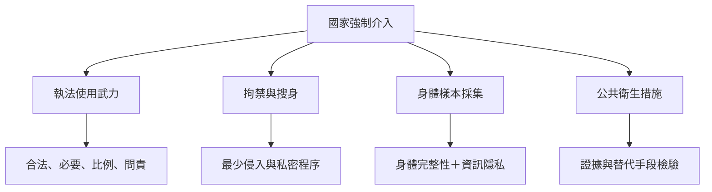

國家以治安、執法、拘禁、公共衛生或證據蒐集為由介入身體時，必須受到法律明確性、必要性、比例性、尊嚴與問責限制。此圖聚焦強制採血、警察武力、拘禁搜身與公共衛生措施。

**雙向連結**：[[比例原則]]、[[身體安全]]、[[資訊隱私]]、[[拘禁中的搜身必須採取最少侵入且可問責的方式]]、[[執法人員使用武力須符合合法必要比例與問責原則]]、[[強制採血同時侵入身體並取得高度敏感的生物資訊]]、[[公共衛生措施限制身體權利仍須通過比例原則檢驗]]
