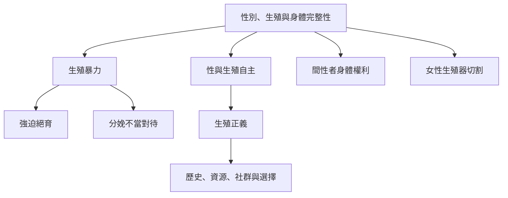

性別與生殖議題呈現身體完整性如何受到家庭、醫療、文化與國家政策共同塑造。分析必須同時反對傷害性實踐與避免污名化社群，並把生殖決策、服務可近性及歷史不平等放在一起。

**雙向連結**：[[身體自主]]、[[生殖正義]]、[[生殖暴力]]、[[強迫絕育]]、[[間性]]、[[女性生殖器切割]]、[[強迫絕育對多個被邊緣化群體造成制度性身體侵害]]、[[生殖暴力也發生於親密關係醫療機構與制度之中]]、[[秘魯原住民女性強迫絕育揭示生殖權利框架的去殖民限制]]
