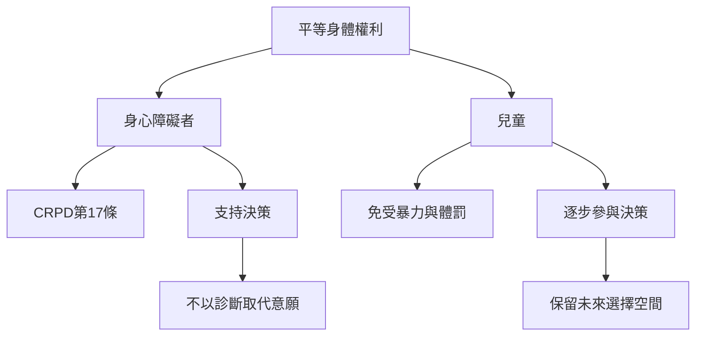

兒童與身心障礙者常被置於由成人、監護人或專業機構代為決定的位置。此圖強調平等享有完整性、支持決策、兒童逐步參與、免受體罰與保留未來選擇的重要性。

**雙向連結**：[[兒童身體自主]]、[[交織性]]、[[身心障礙者享有與他人平等的身心完整性權利]]、[[兒童免受體罰是身體完整性與公共衛生議題]]、[[支持決策應擴張當事人的決策能力而非取代其意願]]、[[兒童的身體完整性不能被成人管教權吞沒]]、[[不可逆的身體決定應盡可能保留本人日後參與的空間]]
