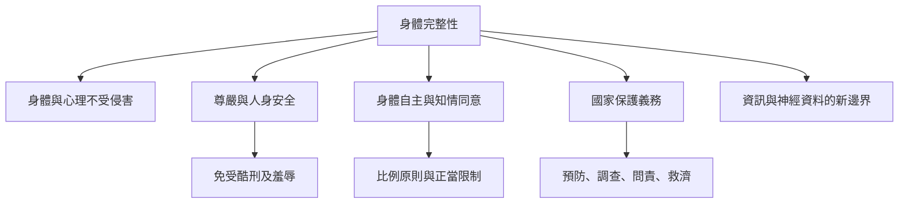

本地圖整理身體完整性作為基本權利的來源、內容、限制與國家責任。核心不是將身體絕對化為不可觸碰，而是要求所有介入都提出正當理由，並尊重人的尊嚴、身體邊界與免受任意侵害的保障。

**雙向連結**：[[身體完整性]]、[[身體自主]]、[[身體安全]]、[[知情同意]]、[[比例原則]]、[[國家積極保護義務]]、[[身體完整性是免於未經同意之身體侵入與傷害的基本人權]]、[[不同法域以明文權利與判例發展身體完整性保障]]、[[身體完整性不能被身體自主完全取代]]、[[身體完整性要求國家同時避免侵害並積極保護]]
