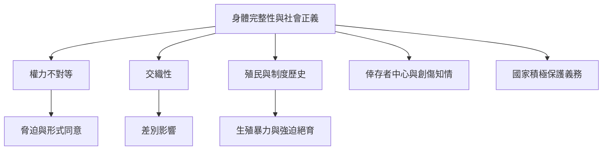

身體侵害往往不是單純的個人衝突，而是性別、族群、階級、障礙、殖民歷史與制度權力交織的結果。此圖將生殖正義、倖存者中心方法、創傷知情照護與國家積極保護義務放在同一框架中。

**雙向連結**：[[交織性]]、[[生殖正義]]、[[脅迫]]、[[倖存者中心方法]]、[[創傷知情照護]]、[[權力不對等會使形式同意失去自由性]]、[[生殖正義必須納入歷史物質條件與社群經驗]]、[[身體完整性需要倖存者中心與創傷知情的制度回應]]、[[秘魯原住民女性強迫絕育揭示生殖權利框架的去殖民限制]]
