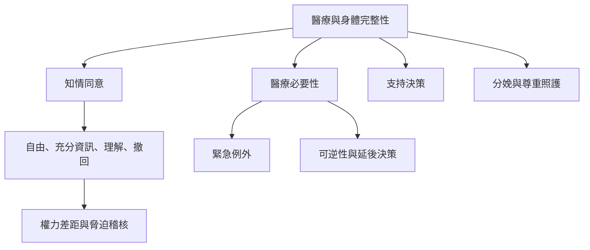

醫療介入會直接接觸身體，因此知情同意、必要性、可逆性與支持決策是保障完整性的核心工具。此圖連結一般醫療程序、緊急例外、不可逆處置、分娩照護及身心障礙者支持決策。

**雙向連結**：[[知情同意]]、[[醫療家長主義]]、[[醫療必要性]]、[[創傷知情照護]]、[[有效醫療同意必須事前自由知情且能隨時撤回]]、[[間性者遭受非必要且未經同意的正常化醫療介入]]、[[身心障礙者享有與他人平等的身心完整性權利]]、[[分娩照護中的不尊重與非合意程序侵害女性身體完整性]]、[[不可逆的身體決定應盡可能保留本人日後參與的空間]]
