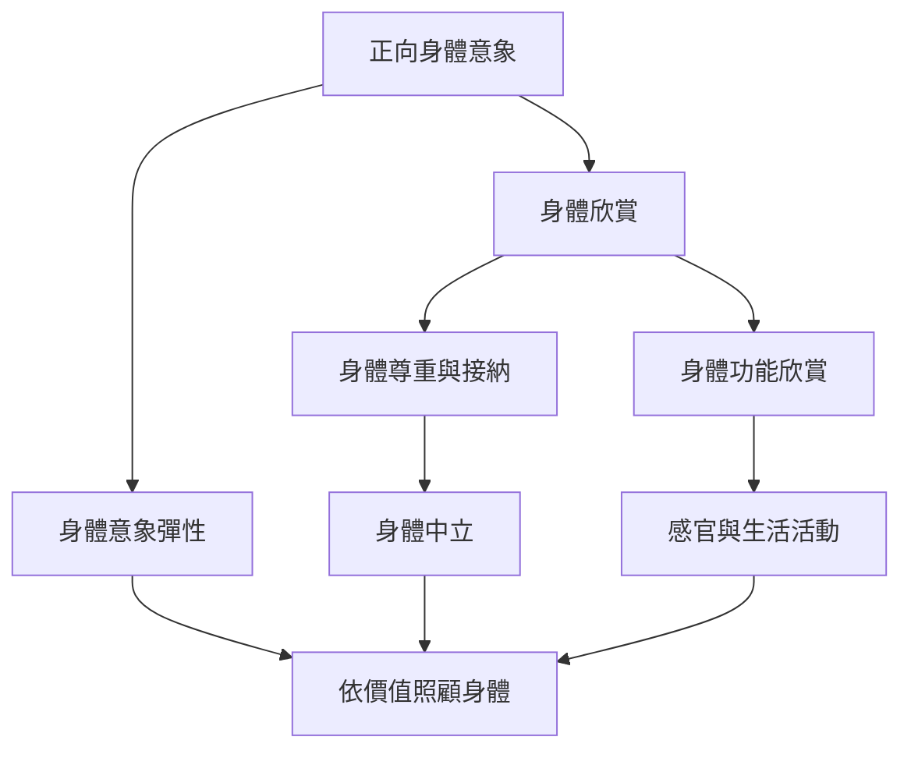

這張地圖聚焦身體欣賞、身體中立與身體功能欣賞，將概念轉為可選擇、可調整且不帶強迫性的日常實踐。重點不是追求永遠正向，而是能在不同狀態下保有尊嚴與照顧。

概念：[[正向身體意象 Positive body image]]、[[身體欣賞 Body appreciation]]、[[身體中立 Body neutrality]]、[[身體功能欣賞 Functionality appreciation]]、[[身體意象彈性 Body image flexibility]]、[[具身性 Embodiment]]。
永久筆記：[[正向身體意象不要求每天都對外貌感到滿意]]、[[身體中立讓照顧不必依賴外貌喜愛]]、[[身體功能欣賞把注意力從外貌轉向身體能經驗與完成的事]]。
靈感：[[設計以身體功能與感官經驗為核心的散步練習]]、[[從身體中立出發設計沒有正向情緒門檻的自我照顧清單]]。

回到導讀：[[Body_image]]
