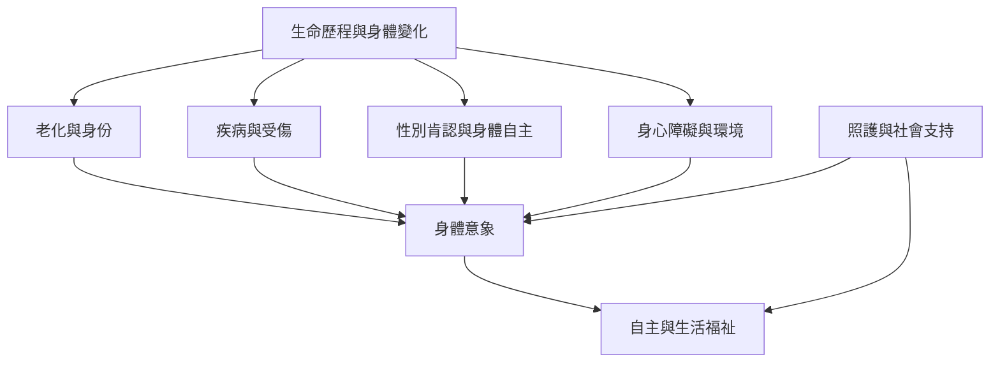

身體意象會隨年齡、疾病、受傷、性別認同與能力變化而重新組織。這張地圖整理不同身體處境的研究入口，也提醒照護需尊重自主、文化差異與生活功能。

概念：[[身體意象 Body image]]、[[身體圖式 Body schema]]、[[具身性 Embodiment]]、[[交織性 Intersectionality]]。
文獻：[[老年人的身體意象同時涉及能力感身份與優雅老化規範]]、[[可見身心障礙女性的身體意象包含外貌與功能互相作用的經驗]]、[[性別肯認照護與跨性別及多元性別者的身體不滿改善相關]]。
永久筆記：[[身體意象會隨生命階段與身體變化持續重組]]、[[身心障礙者的身體意象會在能力外貌與環境互動中形成]]、[[性別肯認照護應以個人自主與生活福祉為中心]]。
靈感：[[為不同生命階段建立身體變化敘事資料庫]]。

回到導讀：[[Body_image]]
