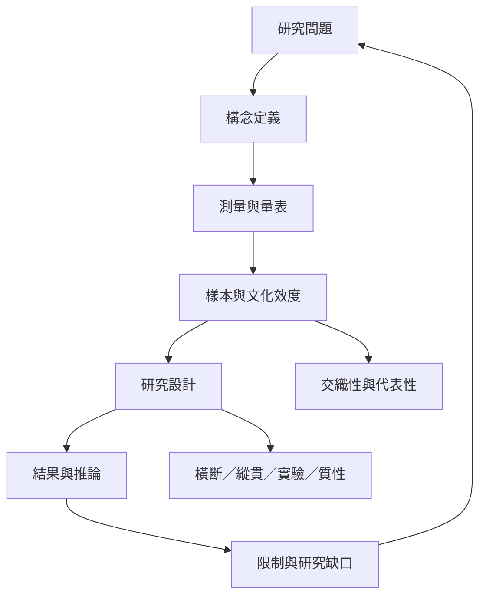

這張地圖整理身體意象研究如何定義構念、選擇測量工具、建構樣本與推論因果。它可作為讀論文時的檢查表，避免把相關研究當成因果證據，或把特定樣本的結果當成普遍事實。

文獻：[[身體意象測量需要從單一量表走向文化敏感與生活情境效度]]、[[身體意象與身體圖式是相關但不可混為一談的身體表徵]]、[[社群媒體中的外貌比較與較差身體意象呈現穩定關聯]]。
概念：[[身體意象 Body image]]、[[身體圖式 Body schema]]、[[交織性 Intersectionality]]。
永久筆記：[[身體意象測量必須先說清楚測量的是哪一種經驗]]、[[介入方案需要由受影響社群共同設計]]。
靈感：[[研究身體意象時讓參與者共同決定語言與測量方式]]。

回到導讀：[[Body_image]]
