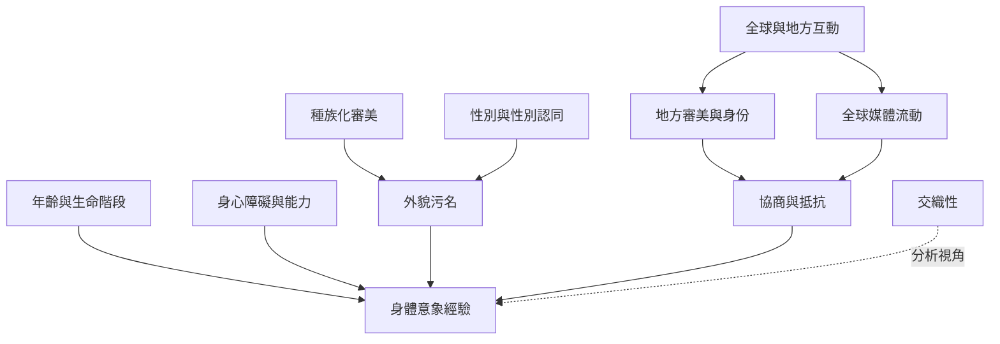

這張地圖把全球文化案例放在同一個比較框架中，但不將各群體經驗視為可互換。閱讀時要同時留意文化認同、殖民與種族化規範、媒體流動、地方社會變遷及研究代表性。

概念：[[交織性 Intersectionality]]、[[具身性 Embodiment]]、[[身體意象 Body image]]、[[體重污名 Weight stigma]]。
文獻：[[文化差異系統性回顧顯示身體意象同時受全球化與地方文化形塑]]、[[斐濟女性的身體理想會隨媒體與社會變遷而協商]]、[[中國年輕女性對社群媒體身體正向內容同時認同也保持批判]]、[[黑人女性的身體意象需要納入種族化審美與性別種族歧視]]、[[拉丁裔女性的正向身體意象與文化根源及交織身份有關]]、[[Wayuu 身體意象研究呈現文化認同與全球審美壓力的交織]]。
永久筆記：[[全球身體理想不是一個由西方單向輸出的固定模板]]、[[交織性揭示不同社會位置如何共同塑造身體經驗]]。
靈感：[[製作跨文化身體理想比較表時應同時呈現研究缺口]]。

回到導讀：[[Body_image]]
