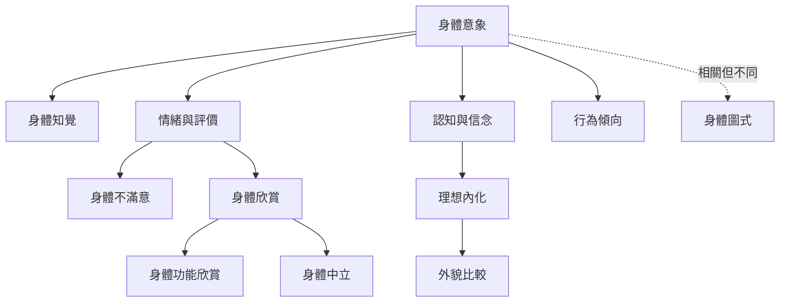

這張地圖整理身體意象的基本構成，並區分主觀外貌經驗與支援動作的身體圖式。閱讀時可由核心定義進入，再分別走向知覺、情緒、比較、污名與身體功能。

概念：[[身體意象 Body image]]、[[身體圖式 Body schema]]、[[身體不滿意 Body dissatisfaction]]、[[正向身體意象 Positive body image]]、[[身體欣賞 Body appreciation]]、[[身體中立 Body neutrality]]、[[身體功能欣賞 Functionality appreciation]]、[[理想內化 Ideal internalization]]、[[外貌比較 Appearance comparison]]。
永久筆記：[[身體意象包含認知情感與知覺等不同面向]]、[[身體圖式支援身體尺度行動而非外貌評價]]、[[正向身體意象不要求每天都對外貌感到滿意]]。
靈感：[[建立身體意象日誌時應記錄情境而不只記錄滿意程度]]、[[設計以身體功能與感官經驗為核心的散步練習]]。

回到導讀：[[Body_image]]
