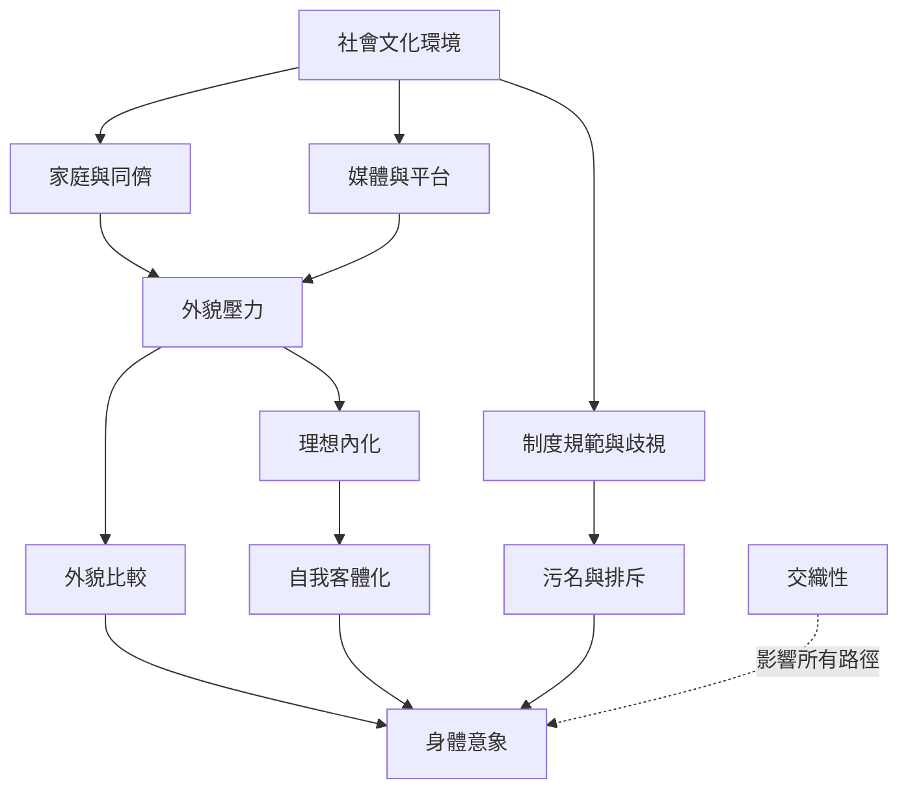

身體意象在社會互動與制度中形成。這張地圖將家庭、同儕、媒體、審美標準、自我客體化、污名與交織性連在一起，並提醒讀者：個人感受既真實，也受到結構條件影響。

概念：[[社會比較理論 Social comparison theory]]、[[客體化理論 Objectification theory]]、[[三方影響模型 Tripartite influence model]]、[[理想內化 Ideal internalization]]、[[自我客體化 Self-objectification]]、[[身體監控 Body surveillance]]、[[體重污名 Weight stigma]]、[[交織性 Intersectionality]]。
永久筆記：[[外貌比較會把他人的影像轉化為評價自己的尺]]、[[身體意象是個人經驗也是社會制度的產物]]、[[交織性揭示不同社會位置如何共同塑造身體經驗]]。
靈感：[[將社群媒體整理成能降低外貌比較的多元資訊環境]]、[[把身體意象教育從個人自信擴展到制度與媒體識讀]]。

回到導讀：[[Body_image]]
