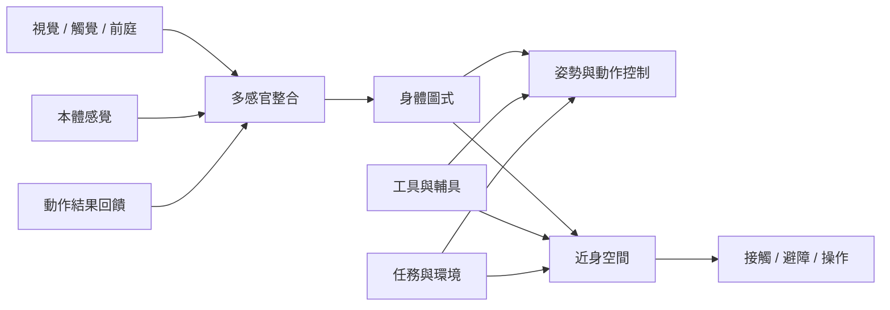

身體圖式在行動中與感覺訊息、近身空間及環境任務共同運作。這張地圖將身體部位定位、感覺回饋、工具操作與空間可行動性連在一起。

核心閱讀：[[本體感覺提供身體圖式更新姿勢與肢體位置的重要線索]]、[[身體圖式透過多感官整合而不是單一感官輸入更新]]、[[近身空間是以行動可能性組織的身體周遭空間]]。

概念入口：[[感覺運動整合]]、[[近身空間]]、[[多感官整合]]、[[工具具身化]]、[[動作圖式]]。

回到導讀：[[Body_schema]]。
