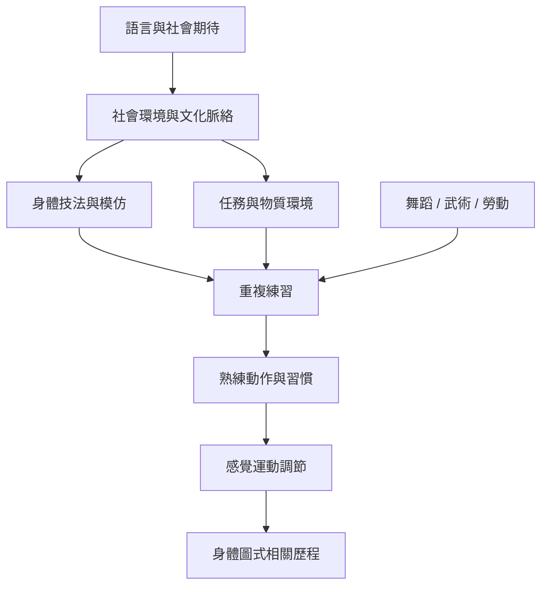

動作能力不只來自個體感覺運動系統，也受到身體技法、訓練、語言、環境與社會期待塑造。這張地圖將神經科學層次與人類學、舞蹈及跨文化研究並置，但不把它們視為同一種證據。

核心閱讀：[[身體圖式的形成同時受個人練習與社會技法影響]]、[[文化差異會經由動作練習進入感覺運動習慣]]、[[身體知識不只存在個體也存在共同實踐與照護關係]]。

概念入口：[[具身性]]、[[生成論]]、[[身體技法]]、[[文化差異與動作習慣]]。

回到導讀：[[Body_schema]]。
