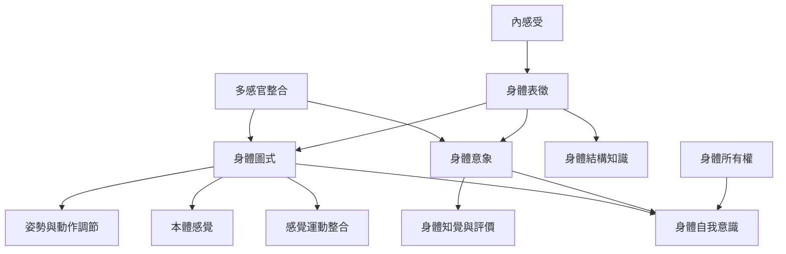

身體圖式不是身體知識的總稱，而是身體表徵家族中偏向行動與姿勢調節的一組功能。此地圖整理身體圖式與身體意象、身體所有權、內感受及本體感覺的關係，並保留分類尚未統一的事實。

核心閱讀：[[身體圖式是讓身體能即時行動的感覺運動組織]]、[[身體圖式不是一張單一而完整的身體內在地圖]]、[[身體圖式與身體意象必須依研究問題區分而非二分化]]。

概念入口：[[身體圖式]]、[[身體意象]]、[[本體感覺]]、[[內感受]]、[[身體所有權]]、[[身體自我意識]]、[[多感官整合]]。

回到導讀：[[Body_schema]]。
